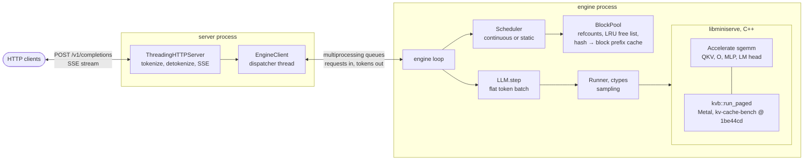

# mini-serve

A small LLM inference server for Apple silicon with **continuous batching**, a **paged KV cache**
with a **prefix cache**, and an OpenAI-compatible streaming `/v1/completions` endpoint. It serves
[SmolLM2-135M](https://huggingface.co/HuggingFaceTB/SmolLM2-135M) (Llama architecture). Matrix
multiplications run on the CPU through Accelerate; attention runs on the GPU through the paged
decode-attention Metal kernel of [kv-cache-bench](https://github.com/chipontix/kv-cache-bench),
pinned to commit `1be44cd`.

The point is the serving layer: how blocks of KV cache are allocated, shared and reclaimed, how a
scheduler admits, batches and preempts requests, and what that buys over a static batch on the
same request stream. The model is tiny on purpose, so the whole thing runs on a laptop and the
interesting costs (scheduling, cache capacity, step overheads) are not hidden behind a large model.

The design follows published work, cited where it is used: PagedAttention and block-level KV
management (Kwon et al., *Efficient Memory Management for Large Language Model Serving with
PagedAttention*, SOSP 2023), iteration-level ("continuous") batching (Yu et al., *Orca*, OSDI 2022),
hash-chained prefix blocks as in vLLM's automatic prefix caching. No code was taken from vLLM,
llama.cpp, MLX or other servers.

## What is shown, and by what

| Claim | Evidence |
|---|---|
| The engine computes the same logits as Hugging Face transformers | `make test`, `tests/test_logits.py`: 5 prompts, every position, prefill and token-by-token decode, fp32 and fp16 KV cache, against `transformers` on the CPU ([tolerances](#correctness)) |
| The tolerance would catch small real bugs | [`scripts/tolerance_probe.py`](scripts/tolerance_probe.py): an RMSNorm eps or RoPE theta off by a little gives 3–4× the fp32 tolerance |
| Block pool, prefix sharing, preemption and both schedulers keep every sequence's KV history intact | `make test`, `tests/test_scheduler.py`: a fake model checks, for every computed token, that the block table resolves to exactly that sequence's tokens |
| Those tests can tell a broken pool or scheduler from a correct one | `make mutation`: 11 injected bugs (stale cache entry, unchained hash, leaked blocks on preemption, …), each caught ([`scripts/mutation.py`](scripts/mutation.py), [`results/mutation.txt`](results/mutation.txt)) |
| The HTTP API streams the same text it returns without streaming, and concurrent requests get the same tokens as sequential ones | `make test`, `tests/test_server.py` |
| `/metrics` is valid Prometheus text and counts what was served | `make test`, `test_metrics_match_load_and_stats`: deltas after a known load, and the same engine counters as `/stats` |
| Continuous batching and the prefix cache vs a static batch, on one request stream | [Numbers](#numbers) (`make bench`) |

CI ([`.github/workflows/ci.yml`](.github/workflows/ci.yml)) runs `make test` on a GitHub `macos-15`
Apple silicon runner, Metal included. No performance number comes from CI.

## Run

Requirements: macOS on Apple silicon, Xcode command line tools, CMake ≥ 3.28,
[uv](https://docs.astral.sh/uv/) (Python 3.12 venv), network access for the first build (kv-cache-bench
source; ~270 MB of weights, which `make weights` puts in the standard Hugging Face cache,
`~/.cache/huggingface/hub`, or `$HF_HUB_CACHE`).

```bash
make test        # build, download weights, venv; scheduler, HTTP and logit tests
make serve       # http://127.0.0.1:8000
make mutation    # inject 11 bugs into pool/scheduler, check the tests catch each
make bench LABEL=mine    # static vs continuous vs continuous+prefix, writes results/mine/
python3 scripts/tables.py mine    # the README tables from results/mine/summary.csv
make reference   # regenerate tests/data/reference.npz (needs torch + transformers, own venv)
```

```bash
curl -N http://127.0.0.1:8000/v1/completions -H 'Content-Type: application/json' \
  -d '{"prompt": "The capital of France is", "max_tokens": 16, "temperature": 0, "stream": true}'
```

Request fields: `prompt` (string or token ids), `max_tokens`, `temperature` (0 = greedy), `stream`,
and `ignore_eos` (an extension, as in vLLM: generate exactly `max_tokens`). `GET /stats` returns the
engine's counters (steps, rows, preemptions, prefix hits, time split) for the benchmark.

### Metrics

`GET /metrics` serves Prometheus text format (0.0.4), written without a client library
([`mini_serve/metrics.py`](mini_serve/metrics.py)). Engine-side numbers come from the engine
process with each scrape; request latencies are measured in the HTTP process, from the moment the
request is read to the first and last token handed to the client.

| metric | type | what |
|---|---|---|
| `mini_serve_requests_total{outcome}` | counter | `ok`, `aborted` (client went away), `rejected` (does not fit the KV pool), `bad_request` |
| `mini_serve_prompt_tokens_total`, `mini_serve_generation_tokens_total` | counter | prompt tokens accepted, tokens sampled |
| `mini_serve_steps_total{kind}`, `mini_serve_step_rows_total{kind}` | counter | engine steps and token rows, `prefill` / `decode` |
| `mini_serve_preemptions_total`, `mini_serve_prefix_cache_hit_blocks_total` | counter | sequences preempted, KV blocks reused from the prefix cache |
| `mini_serve_engine_seconds_total{part}` | counter | time in the C++ forward pass (`forward`), and its `matmul` and `attention` parts |
| `mini_serve_running_sequences`, `mini_serve_waiting_sequences` | gauge | batch and queue size |
| `mini_serve_kv_blocks_free`, `mini_serve_kv_blocks_total` | gauge | KV pool occupancy |
| `mini_serve_step_seconds` | histogram | wall time of one engine step |
| `mini_serve_time_to_first_token_seconds`, `mini_serve_time_per_output_token_seconds`, `mini_serve_request_seconds` | histogram | TTFT, mean TPOT per request, end-to-end latency |

```yaml
scrape_configs:   # prometheus.yml
  - job_name: mini-serve
    static_configs: [{targets: ["127.0.0.1:8000"]}]
```

## Architecture



| File | What it is |
|---|---|
| [`src/engine.cpp`](src/engine.cpp) | Llama forward pass over the paged KV pool; C API for ctypes |
| [`mini_serve/blocks.py`](mini_serve/blocks.py) | block pool: allocation, refcounts, hash-chained prefix cache, LRU reuse |
| [`mini_serve/scheduler.py`](mini_serve/scheduler.py) | continuous scheduler with preemption; static-batch baseline |
| [`mini_serve/llm.py`](mini_serve/llm.py) | one step: scheduler → flat token batch → runner → scheduler |
| [`mini_serve/engine.py`](mini_serve/engine.py) | weight loading (safetensors → fp16), ctypes binding, sampling |
| [`mini_serve/server.py`](mini_serve/server.py) | HTTP server, engine process, streaming detokenizer |
| [`bench/run.py`](bench/run.py) | load generator and benchmark driver |
| [`tests/`](tests/) | scheduler/pool, HTTP, logits vs transformers |

**One step, one forward call.** A step is a flat list of tokens from any number of sequences. Each
token comes with its position and its sequence's block table. The engine writes the token's K and V
into its slot (`block_table[pos / page]`, offset `pos % page`) and then lets it attend to positions
`0..pos` of its sequence. A decode step is one token per running sequence. A prefill of an `L`-token
prompt is `L` rows sharing one block table, with positions `0..L-1`.

**Prefill through a decode kernel.** The kv-cache-bench kernel computes attention for one query per
"sequence" over that sequence's first `seq_len` cached tokens. Giving every prompt token its own row
with `seq_len = pos + 1` is exactly causal attention, so the same kernel serves prefill, decode and
a prefill that starts after a cached prefix, with no mask and no second kernel. The cost is that a
prompt of `L` tokens reads `L(L+1)/2` K/V rows instead of a tiled `L × L` pass; at the prompt lengths
used here (≈ 250 tokens) that is a small part of a prefill step.

**Model.** SmolLM2-135M: 30 layers, hidden 576, 9 query heads and 3 KV heads of dimension 64
(grouped-query attention), SwiGLU MLP 1536, RoPE θ = 100000, tied embeddings, vocabulary 49152.
The checkpoint is bf16; it is rounded once to fp16 at load (the model in fp16), and the CPU
computes in fp32 from those values. Q/K/V and gate/up projections are stacked so each is one GEMM.
The KV cache is fp16 (an fp32 mode exists for tests).

**Block pool and prefix cache.** A block holds `page_size = 16` tokens of K and V for all layers and
heads. Each sequence has a block table; blocks have reference counts. When a block becomes full, it
is registered under a hash chained from the previous block's hash and its own 16 token ids, so a
hash identifies the whole prefix, not just the block. A new request looks up its prompt's full
blocks, takes references on the hits and computes only the rest. Only full blocks are shared and a
sequence only writes into its own last block, so no copy-on-write is needed. At least the last
prompt token is always computed (its logits give the first output token), so a prompt that is
entirely cached recomputes its last block. Freed blocks keep their hash on an LRU free list and can
still be hit until they are reused.

**Continuous scheduler.** Between steps, waiting requests are admitted first-come-first-served while
the pool has blocks for their uncached tokens and a prefill budget (2048 tokens per step) allows.
If anything was admitted, the step prefills only those; otherwise it decodes all running sequences.
Prefill and decode are never mixed in one step. A finished sequence frees its blocks immediately.
When a decoding sequence needs a new block and the pool is empty, the most recently admitted
sequence is preempted: its blocks are freed and it goes back to the front of the queue, to be
recomputed later from its prompt plus the tokens generated so far.

**Static baseline.** When nothing is running, take up to `max_num_seqs` waiting requests, reserve
all blocks they could need (prompt + `max_tokens`), prefill them together and decode until the last
one finishes. New requests wait for the whole batch. No prefix cache, no preemption needed.

**Two processes.** The engine loop runs in its own process; the HTTP server talks to it through two
queues (see [What I learned](#what-i-learned)).

## Correctness

The reference is `transformers` 4.57.6 / `torch` 2.8.0 on the CPU, fp32, eager attention, with the
same fp16-rounded weights ([`scripts/make_reference.py`](scripts/make_reference.py), versions in
[`tests/data/reference.json`](tests/data/reference.json)). Stored per prompt: the full logits of the
last position, the top-20 logits of every position, and a 16-token greedy continuation.

Compared: the engine's logits at the reference's top-20 token ids of every position (the full
vocabulary for the last position); the argmax wherever the reference's top two differ by more than
twice the tolerance; and the greedy continuation through the full scheduler with all 5 prompts in
one batch.

| check | fp32 KV cache | fp16 KV cache |
|---|---:|---:|
| tolerance (max abs logit error) | 5e-3 | 3e-2 |
| observed, this Mac / CI runner: prefill | 1.26e-3 / 2.16e-3 | 8.74e-3 / 1.17e-2 |
| observed, this Mac / CI runner: decode | 2.65e-4 / 1.68e-4 | 7.26e-3 / 7.18e-3 |

Logits are up to ≈ 40 in magnitude, so the fp32 error is a relative 3e-5 to 5e-5: fp32 rounding
over 30 layers, with summation orders that differ between Accelerate's GEMMs, the Metal kernel and
PyTorch. The fp16 cache adds the rounding of every stored K and V element (unit roundoff 2⁻¹¹).

From the other side ([`results/tolerance-probe.txt`](results/tolerance-probe.txt)): RMSNorm eps
1e-6 instead of 1e-5 gives an error of 1.75e-2, RoPE θ off by 1% gives 1.34e-2; both fail the fp32
tolerance by a factor of 2.7–3.5. They would pass the fp16 tolerance: fp16 storage noise is about as
large as these bugs, which is why the test also runs with an fp32 cache.

## Numbers

Pending: the final run is made on a quiet machine. Until then this section has no numbers, and
none of the draft runs made while developing (on a machine at load average 40–80) are reported.

## What I learned

1. **In one Python process, the HTTP threads competed with the engine for the GIL.** The first
   server ran the engine loop in a thread next to the handler threads. The forward pass releases
   the GIL (ctypes), but after every step the engine thread had to get it back from threads busy
   decoding and writing tokens, and in draft runs a large share of each step was spent outside the
   C++ forward pass, against a few percent for the same steps run offline. The engine now runs in
   its own process. The A/B ([`scripts/gil_ab.sh`](scripts/gil_ab.sh), commit `d1c9880` vs this one)
   is pending the quiet-machine run.
2. **Requests that arrive in the same step do not share their prefix.** Blocks are registered in
   the cache after the step that computed them, so a burst of requests with the same system prompt
   admitted together all compute it. The scheduler test had to admit one request first to see any
   hits; in the benchmark, arrivals are spread out and only a burst at start-up pays.
3. **A decode-only attention kernel can serve prefill.** One row per prompt token with
   `seq_len = pos + 1` is causal attention for free, and a prefix-cache hit is just a prefill whose
   positions start later.

## Limitations

- One small model (135M parameters, Llama architecture only, head dim 64 or 128 as the kernel
  requires). Results about absolute speed say little about large models, where the matmuls dominate
  differently and the GPU would run them.
- Matmuls run on the CPU (Accelerate, fp32 from fp16-rounded weights). Each layer waits for the GPU
  once (`kvb::run_paged` commits and waits), i.e. 30 CPU↔GPU round trips per step.
- Prefill and decode are never mixed in a step (no chunked prefill): a long prefill delays every
  running sequence's next token.
- Preemption only recomputes; no swapping to CPU memory. Victim choice is "most recently admitted".
- Prefix sharing is per full block of 16 tokens; a shared prefix that ends mid-block shares only its
  full blocks. Hashes are Python `hash` of token tuples, chained; collisions are not checked.
- Sampling: greedy or temperature only (no top-p/top-k, no stop strings, no logprobs, no `seed`).
- No authentication, no request size limits beyond the KV pool size, single model, single node.

## How it was built

The code, tests and documentation of this repository were written by the AI agent Claude Code
(Anthropic), working from Rabiya's problem statement and under her direction: she set the task, the
constraints (model, kernel commit, what to measure), and reviewed and accepted the results.

## License

MIT, see [LICENSE](LICENSE). The model weights (Apache-2.0) are downloaded at build time and not
redistributed. The attention kernel comes from chipontix/kv-cache-bench (MIT).
